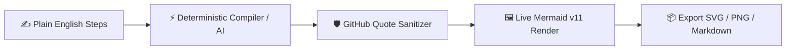

# 📐 DiagramCraft AI

> **Plain-English & Code-to-Mermaid Diagram Studio with Auto-Sanitized GitHub Syntax & SVG/PNG Export.**

---

## ⚡ Features

- ✍️ **Plain English to Architecture**: Write `Step A -> Step B -> Step C` and instantly generate Flowcharts or Sequence Diagrams.
- 🛡️ **GitHub Red-Box Prevention**: Built-in linter and 1-click sanitizer automatically quotes labels with parentheses or slashes (`A["Node (Info)"]`) so GitHub READMEs never show `Parse error` boxes.
- 🖼️ **Instant Export**: Download crisp vector `.svg` or high-DPI dark-mode `.png` images.
- ✨ **Shared AI Architect**: Inherits your Ollama / BYO API configuration from [Krishna.OS](https://krishnagupta-coder.github.io/) when deeper architectural generation is needed.

---

## 🏗️ Workflow

---

## 📜 License

MIT License — see [LICENSE](LICENSE).
